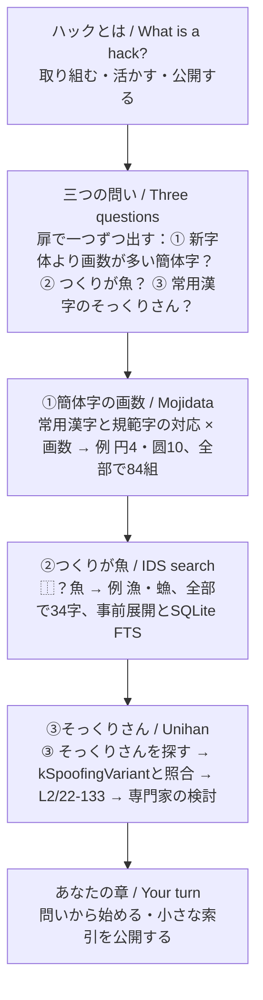
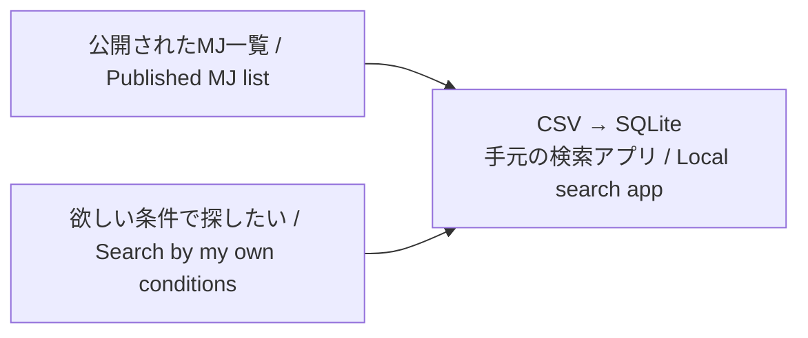
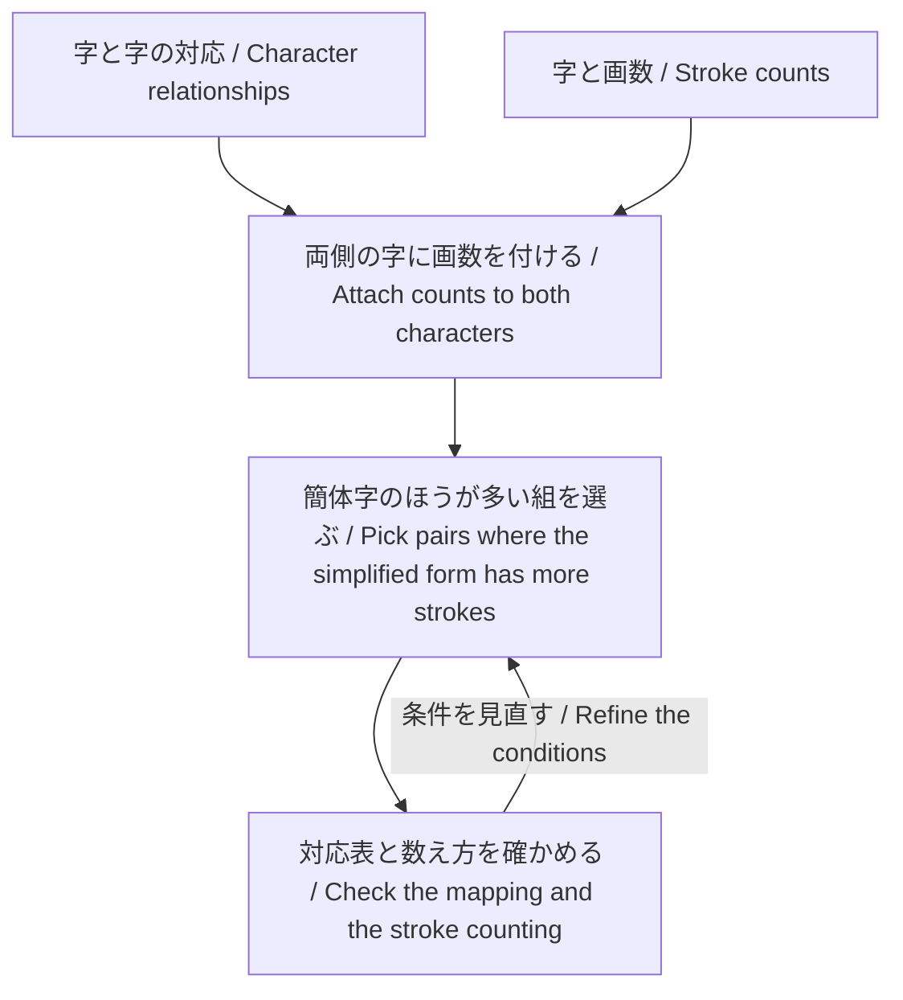
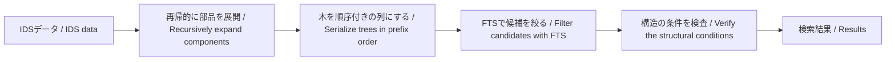
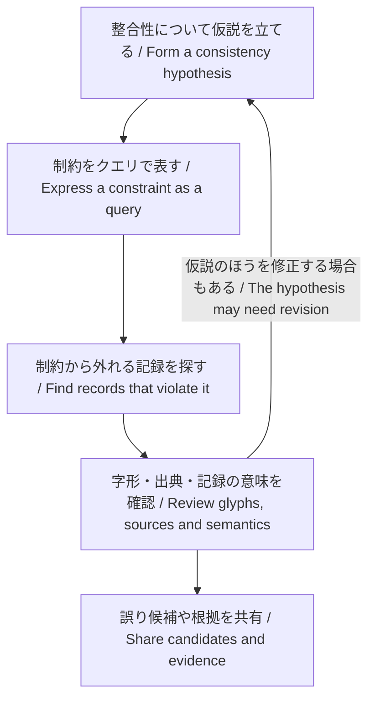

# BiangBiangCon 文字情報ハックのすすめ 発表案

「そこにデータがあるのに検索できない」という不満から、自分で調べられるようにしてきた経験を話す。2011年のMJ文字情報の検索と、MojidataのIDS検索を二つの柱にする。データを取り込む、資料をつなぐ、既存技術を別の用途に使う、矛盾や不足を見つけて共有する。その過程を通じ、今あるデータと技術を知り、自分の疑問に組み合わせて使う姿勢を伝える。

Mojidataは実践の道具として登場する。聴衆に勧めるのは、特定のソフトウェアを使うことだけでなく、公開データを分析し、自分の成果も他の人が使える形で公開すること。SQLを書いたことがない漢字好きの人にも、調べる側・データを整える側のどちらからでも参加できる入口を示す。

本書を新案の正本とする。[旧Mojidata発表案](mojidata-presentation.md)と旧スライドは保持する。調査のSQLや詳細な結果は既存の調査記録を参照し、本書では発表の筋と見せ方を定める。現在のスライドは日英併記の[Slidev原稿](biangbiangcon-character-hacks/slidev/slides.md)を正本とし、[スタイル](biangbiangcon-character-hacks/slidev/style.css)を分けて編集する。本編25枚。補足スライドは乱雑だったので2026-10-14にいったん外し、参照文献の1枚（30枚目）だけ残した。2026-10-15に「ハックとは」を本編から補足（29枚目）へ、③の「今やると」の2枚を補足（26・27枚目）へ移し、①②③の直前に扉（4・14・20枚目）を足した。続けて、三つの問いを冒頭で並べていた「字典の索引では引けない問いがある」を外し（答えの先取りになり、いきなり三問並ぶため）、「材料も道具も、すでに公開されている」を①の例の直後（6枚目）へ移した。2026-10-16に、補足（28枚目）として𬂛（U+2C09B）と𬺰（U+2CEB0）の関係を足した（MJではどちらも「えだなし」、名字の用例は「もぎき」、Unihanには二つの間の異体関係がない。kStrangeは𬂛がI:U+6728、𬺰がI:U+624D）（ほかの題材は「補足に置く題材と根拠」に残す。スライドはjjの履歴にある）。[以前のPowerPoint案](biangbiangcon-character-hacks/slides-v2.pptx)と[以前のPDF](biangbiangcon-character-hacks/slides-v2-preview.pdf)も残す。

## 題目と概要

主催者に伝えているのは題目だけで、概要は未提出。必要になったら下の文を使う。

- 日本語題：文字情報ハックのすすめ
- 英題：An Invitation to Hacking Character Data
- 中国語題：动手玩转文字数据（AI翻訳で「ハック」が「黑客」「破解」になるのを避け、意図を先に見せるため、表紙に添える。中国語話者による確認はまだ）

> 字典の部首・画数・読みの索引では引けない問いがあります。「常用漢字より画数が多い簡体字は？」「つくりが魚の漢字は？」「常用漢字にそっくりな字はある？」。こうした自分の問いに、公開された文字データと既存の技術を組み合わせて答えてきた経験を紹介します。文字情報をつなぐMojidataでは表をつないで画数を比べ、IDS検索では部品を事前に展開してSQLiteの全文検索で漢字の構造を引けるようにしました。そっくりな字の調査は、Unihanへの提案と採用につながりました。面白い問題に自発的に取り組み、既存の成果や技術を活かし、見つけたことを公開する。プログラミングに馴染みがない人も、使える道具やAIの力を借りて参加できる、文字情報ハックへの入口を示します。

## 構成の全体像

### BiangBiangConで話す位置

BiangBiangConは、IRG
#67の日本開催を機に、若手の文字研究者・技術者・愛好家の交流と、文字コードへの関心・標準化活動の活性化を目指す会（[旧案の開催情報](mojidata-presentation.md#biangbiangconの開催情報)）。公開プログラムでは、本発表の直前にKen
Lunde「My Brief History of
Standardization」と陶扬（中国の地名コード）、直後に白易「zi.toolsにおけるIDSシステムの紹介」が並ぶ。各発表にはAIによる翻訳字幕が付く予定。主催者からは、スライドは4:3を推奨（配信で右側にAI翻訳を載せるため）、現場にWi-Fi・投影用PC・マイクがあると案内されている。

ここから、構成を次のように決める。プログラム順や聴衆像からの判断であり、主催者から指定された役割ではない。

- **標準を作る側の話の後に、使う側から何ができるかを話す。**
  山場は、IDS検索で見つけた類似字をUnihanへ提案し、採用された経過に置く。提案はkSpoofingVariantまたはkZVariantとしての追加で、個々の分類はUTCの専門家に委ねた。組織上はCJK & Unihan GroupがUTCへUnicode 15.0に向けた更新を勧告する形だが、それはUnicode内部の手続きなので、発表では外から見た大筋の「提案 → 採用」だけを話し、分類の細部も扱わない。直前の標準化史の話を受け、「使う側からも標準のデータへ返せる」ことを具体例で示す。
- **字そのものを見せる。**
  聴衆は文字に関心があり、SQLの経験は揃わない。問いと答えを字形で見せ、技術の説明は一枚に絞る。
- **IDSの基本説明はしない。**
  直後のzi.tools発表と重ならないよう、IDS検索については、IDSを全文検索で引くこと自体はよく知られているため、Mojidataの工夫である「部品の再帰的な事前展開」と「SQLiteのFTSで候補を絞って速くする」一点だけを話す。
- **一般化は一回だけ。** 旧構成（自己紹介 → 問題提起 → 過去事例10枚 →
  ハックのやり方7枚 →
  まとめ）は、データの整形・IDS・誤りの検出を前半と後半で二度説明していた。新構成では事例の中で答えを出し、まとめ直しの枚は置かない（振り返りの枚は、24枚目の「あなたの問いから」と内容が重なるので外した）。
- **新しく分かったことを前に出す。**
  データの誤りの報告が続くと聞き手の印象が重くなるため、本編は「調べたら新しいことが分かった」場面を中心にする。MJ・Unihanの誤りの例は質疑用の補足へ回し、Unihanへの提案も「まだない関係を見つけ、提案し、標準のデータに返った」経過として話す。
- **但し書きは発表者ノートへ。**
  スライドには見せるべき情報（字形、図、短いラベル）だけを置き、説明文・但し書き・出典欄は載せない。根拠と限定は各スライドの発表者ノートの「注：」に残し、読み上げでは必要なもの（候補と確定の区別など）だけを短く言う。出典の一覧は参照文献の補足スライドに置く。
- **見出しは主張にする。**
  アサーション・エビデンス型（Michael Alley）に従い、各スライドの見出しは話題名ではなく主張の一文にし、本文はその証拠（字形・図・表）だけにする。見出しだけを順に読んで筋が通ることを確かめる。各問いの最初のスライドは、見つけた例と「全部では？」という問いを見出しにし（例：「画数の多い簡体字がある。他には？」）、問いは見出しの上に小さく添える。
- **一枚に一つの考え、強調は答えだけ。**
  朱色は答えと主張にだけ使い、矢印やラベルは墨色・灰色にする。本文は縦方向の中央に置く。問い → 答えの場面はクリックで段階表示する（PDFは最終状態）。
- **活かす「既存の成果や技術」を具体的に見せる。**
  6枚目で、Mojidataが実際に使っているデータ（Unihan、BabelStone IDS、MJ文字情報一覧表、常用漢字表、通用規範漢字表など）と技術（SQLiteとその全文検索、JavaScript）を並べ、それらを組み合わせたものがMojidataだと示す。一覧の正本はMojidataリポジトリの packages/mojidata/README.md。
- **答えと解き方を分ける。**
  各問いで、まず見つけた例（字形や数）を見せて「全部を調べたい」という問いにし、解き方を別のスライドにする。例は部分的な答えで、全部の答えは「実行すると、…一度に出てくる」スライドで出す。①②は解き方の次に「ハック」のスライドを置き（見出しには「ハック」と書かず、主張だけを書く）、何が字典を繰るだけではできない工夫なのかを主張する。①は問いをSQLで書けば全部の字について答えが機械的に出ること。公開したjgquery.sql（全54行）を、結果を変えずに3ステップ（表を作る・つなぎ合わせる・絞る）の形に書き直して色分けして載せ、SQL全体が、問いを計算できる程度に詳しく書いたもので、言葉の問いに暗黙に含まれる前提（日中の字の対応のさせ方、画数の出典）を書き下すと長くなることを見せる。前提の決め方は一通りではなく、これはその一つとして示す。その前の1枚で、現行のMojidata（2026-10-10ビルド）で実行した全84行を並べ、常用漢字表に康熙字典体のない字（○）と、規範字表に繁体字のない規範字（●）に印を付ける。印のない15組が問いのいちばん素直な答えで、残りの多くは仏・佛、毎・每のように日本でだけ形が変わった組。「新字体」「簡体字」の線の引き方も表によって違う（叠は規範字表で疊を異体字として扱うので●になる）。正しい答えを一つ出すことより、データを並べると見えてくることが大事だと伝える。書き直した版は[jgquery-steps.sql](biangbiangcon-character-hacks/jgquery-steps.sql)で、公開版と結果が順序まで一致することを確かめてある。クエリの複雑さは問題の複雑さの反映で、①の解き方の図もクエリの構造（広げる・寄せる・画数を付けて比べる）どおりに描く、②は部品の事前展開とSQLiteの全文検索。①は旧字体を経由して簡体字までたどる表のつなぎ方、②はIDSデータを使った構造検索（Mojidataに限らずIDSデータがあれば検索しやすい問題）と、Mojidataでそれを速くする事前展開と全文検索、③は常用漢字表の全字のIDSをids-findにまとめて流し込み（スライドでは、常用漢字 → IDS → 同じIDSを持つ字の表で十𬂛・兵𠔊・田𫭂・逸𨓜を見せる。手順はシェルの数行で書けるが、画面には出さず質疑用のノートに置く。字を渡すと異体として同一視された字まで拾うので、IDSを渡す）、同じ構造の別の字を拾ってUnihanと照合する手順。三つとも、機械的に得た結果を全部並べるスライドを置く（①84組、②34字、③44字に52の候補）。③は本編では「2022年の話」（見つけた例・解き方・照合と提案、採用）までにし、「今やると」（同じ検索の今の全結果と、今のUnihanとの照合）は補足（27・27枚目）に置いて、時期を混ぜない。今のUnihanと照合すると、2022年に提案した組はすべて記録済み（兵𠔊などはkSpoofingVariant、逸𨓜・隆𨺓・志𢖽などはkZVariant）で、記録のない組が13組ある（そっくりと言えるのは辛𨐋だけで、冊䍏・央𰋙・玉玊は少し似ている程度。ほかは土士・未末本・東果・由甲申・巾门のようにIDSでは区別がつかない別の字）。③の再実行（2026-10-11）は、異体の同一視（kZVariantとkdpvの部首異体）を外して作った索引に、常用漢字のIDSを渡して行った。今の索引のままでは、IDSを渡しても同一視が効き、246字に380の候補が出て、その多くは閲閱・姫姬のような同一視でつながっただけの組になる。それを提案すると実質的にkdpvなどのペアをUnihanに提案することになるので、2022年もそういう組は提案していない。十𬂛は、IDS（⿻一丨）を渡せば出る（字を渡すと、2023-04-10のコミットf0af94bで⿻に足した字ごとの隠し引数のため出ない）。③の結果には、IDSでは区別がつかない別の字が混ざり、最後は人が見て選ぶことも見せる。
- **20分に収める。**
  AI翻訳字幕が付くため1分あたり約250字で読む前提にし、本編は25枚・約15分半（自己紹介のデモ約1分を含む）にする。持ち時間に質疑が含まれるかは未確認なので、質疑込みでも収まる長さにする。

### 流れ

軸は「字典の索引は、誰かの問いの形をしている。自分の問いの索引がなければ、公開データから作る」。三つの問いは冒頭で並べず、各問いの扉で一つずつ出して、事例の中で答える。各事例は「自分の問いのための索引を作った」例として見せ、結びの「小さな成果を公開する」も「あなたの索引が次の人の材料になる」と同じ比喩で言う。

発表の立場は、「発表者が自分の問いでできたことを見せ、聞き手が自分なら何ができるかを考える」こと。①②③は方法の講義ではなく、考えるための具体例として見せる。2枚目のMojidataのデモと、3枚目の「集める → 組み合わせる → 公開する」（Mojidataも、公開されたデータと手元の技術を組み合わせたハックとして作った）で発表者の立場を示し、24枚目の「あなたの問いから」で聞き手に渡す。

題の「ハック」は技術者以外にはなじみが薄いため、「取り組む・活かす・公開する」という心構えは、補足（29枚目）に回し、質疑で話す（2026-10-15に本編から外した）。十と𬂛は三つ目の問いで初めて見せ、「返す」の山場へつなぐ。冒頭でいきなり字形だけを見せる始め方は、文脈がなく混乱が大きいので採らない。章を示す爪見出しはノイズになるので置かない。各問いの直前に扉（4・14・20枚目）を置き、問いの番号と問い、イメージ図（①は新字体の漢と簡体字の汉を＜でつなぎ、＜の上に？を置く図、②は左が？で右が魚の字の枠、③は十≒？）を見せる。扉の台本は問いを読み上げるだけにする。いまどの問いの話かは、各スライドの見出しの上に小さく添える問いで示す。2011年のMJ検索（mjview）の画面は、索引を軸にした構成ではノイズになるため本編に出さない。



### 本編25枚の場面と見せ方

時間は発表者ノートの台本の目安（[発表台本](#発表台本)を参照）。本編は約15分半（2026-10-15に扉を足し、「字典の索引では引けない問いがある」を外して時間を測り直し、2枚目はMojidata Web Appのデモを含めて80秒とした）で、持ち時間20分なら質疑込みでも約4分を質疑か、16枚目でのIDS検索の実演（＋2分程度）に使える。

| 区分       | スライド | 開始  | 見出し（主張）と画面                                                                                                                                                                                                                                                                                                                                                                                                                                                                                                                                                                                    |
| ---------- | -------- | ----- | ------------------------------------------------------------------------------------------------------------------------------------------------------------------------------------------------------------------------------------------------------------------------------------------------------------------------------------------------------------------------------------------------------------------------------------------------------------------------------------------------------------------------------------------------------------------------------------------------------- |
| 導入       | 1–3      | 0:00  | 表紙。自己紹介（Mojidata Web Appを作っているプログラマーとして、その場でアプリをデモする）。Mojidataも、公開されたデータを集め、手元の技術と組み合わせ、公開したハックとして作ったことを示し、題の「ハック」につなぐ。三つの問題を通して紹介すると予告する                                                                                                                                                                                                                                                                                                                                              |
| ① 簡体字   | 4–13     | 2:10  | 扉：新字体より画数が多い簡体字は？（漢 ＜ 汉 の上に ？）。画数の多い簡体字がある。他にもある？（気・発・広・電の典型例と、円・圓・圆）。材料も道具も、すでに公開されている（Unihan、BabelStone IDS、MJ文字情報一覧表、常用漢字表、通用規範漢字表／SQLite、全文検索、JavaScript → Mojidata）。日本と中国で、異体字と画数の表を作る（例は気・発・髪・電。簡体字のほうが画数の少ない組だけにする）。二つの表を、同じ文字でつなぐ（発と髪が一つの发にまとまる図）。つないだ結果は、表の作り方で変わる。対応表は2,145組になる。対応表を画数の条件で絞ると、84組が残る。問いをSQLで書けば、答えが機械的に出る |
| ② 魚       | 14–19    | 9:25  | 扉：つくりが魚の漢字は？（？｜魚）。つくりが魚の字は部首がばらばら。全部探すには？（例：漁、䗨）。②の解き方：IDSデータを使って検索する。実行すると、34字が一度に出てくる。部品を事前に展開し、全文検索で速く引く                                                                                                                                                                                                                                                                                                                                                                                        |
| ③ 2022年   | 20–23    | 12:10 | 扉：常用漢字にそっくりな字はあるか？（十 ≒ ？）。常用漢字にそっくりな字がある。他にもある？（例：十と𬂛）。③の解き方：常用漢字の全字を、構造で検索する。照合すると、Unihanにまだない関係があった（提案 → 採用）                                                                                                                                                                                                                                                                                                                                                                                         |
| あなたの章 | 24       | 14:35 | あなたの問いから、同じ手順で始められる（最後の手順が公開）                                                                                                                                                                                                                                                                                                                                                                                                                                                                                                                                              |
| まとめ     | 25       | 15:15 | 字典にない索引を、公開データから作ろう                                                                                                                                                                                                                                                                                                                                                                                                                                                                                                                                                                  |

1枚目の「ここまで、標準を作ってきた側のお話がありました」は、当日のプログラム順が公開版の通りの場合の言い方。順番が変わったら言い換える。

## 柱1 MJの検索を自分で作る

2011年の[「IPAmj明朝の漢字を検索」](../var/mjlt-111217075152-phpapp01.pdf)は、発表者の出発点として動機の背景と質疑用に残す。本編のスライドには出さない。文字情報一覧が公開されていても、その一覧を欲しい条件で検索できるとは限らない。そこでCSVをSQLiteに取り込み、検索できるソフトウェアを作った。

当時の発表では、Unicodeで符号化されていない字も表示するため、FreeTypeでフォントから直接グリフを取り出していた。検索と字形表示を組み合わせて作った手元のアプリを紹介する。



画面は[2011年11月12日の記事「漢字を検索するソフトを作っている」](https://mandel59.hateblo.jp/entry/20111112/1321094846)に残る[画像](https://cdn-ak.f.st-hatena.com/images/fotolife/m/mandel59/20111112/20111112193741.png)を使う。検索欄は「あたり」、選択字形はMJ060240。当時の画像をそのまま掲載する。

旧発表のTODOには、他のデータとの組み合わせや文字部品の検索もある。ここから、MojidataとIDS検索へ自然につなげる。旧PDFは当時の実践の根拠に使い、現在の仕様やライセンスを証明する資料にはしない。

## 資料をつなぐと、自分の問いを試せる

検索基盤ができると、自分や他の人の漢字の疑問に、その都度条件を作って答えられる。「常用漢字より画数が多い簡体字は？」も、そのための索引が既にある必要はない。本編の問いは、発表者自身が立てて調べた問いから選ぶ。

資料ごとに形式が違うため、取り込めば直ちに同じように扱えるわけではない。Mojidataでは、MJ文字情報やUnihanの複数値を持つセル・プロパティを、定義された区切り方に従って個別のレコードへ分ける。また、符号位置の表記をUCS文字列にそろえ、他の表と結び付けやすくする。

①の例は二つの表で示す。



5枚目では、[2022年7月14日の抽出](https://x.com/mandel59/status/1547293802565496832)（[クエリ](https://gist.github.com/mandel59/8a7cd6cca228723e248d5fccbd41e69a)）を出発点に、常用漢字・旧字体（繁体字）・規範字の3列の表で、日中の字体差の紹介によく使われる典型例（気6・氣10・气4、発9・發12・发5、広5・廣15・广3、電13・電13・电5）を並べ、最後に簡体字のほうが画数の多い組として円4・圓13・圆10だけを見せる（両两・図图・圧压は出さない。2026-10-15に変更）。抽出結果の規範字の列には、佛・收のように中国で簡略化されていない字も含まれるので、問いに合わせて簡体字の組だけを選ぶ。器・墨・増のように字形はほぼ同じで数え方や部品の形が違う組、予・豫のように対応表の選び方が効く組も出さない。当時のデータで、日中で画数の数え方が違う場合は考慮していない。調査の過程（浜→濱→滨のように旧字体を経由して対応を辿る、使う対応表で結果が変わる争・爭、常用漢字表のPDFから亀の旧字体を取り出せていなかった）は質疑で話せる。以前の案で①に使っていた「略す前の画数が一番少ない略字は？」は発表者自身の問いではないため、本編・補足とも使わない。

MJの字形、UCSの抽象文字、読み、異体字関係は同じ単位ではない。表をつなぎやすくすることと、それらを同一視することは別。正規化によって検索しやすくなっても、値や解釈が正しいことまで保証されるわけではない。

## 柱2 IDSの木構造にFTSを応用する

### 「魚を含む」から「つくりが魚」へ

「魚を含む漢字」を探せても、「魚へんの漢字」や「つくりが魚の漢字」を探せるとは限らない。魚へんの字は魚部の索引から多くを見つけられるが、つくりが魚の字は別々の部首に分かれる。紙の字典では、内画数11の字を丹念に見る、といった探し方になる。

MojidataのIDS検索では、**⿰？魚**というクエリを使える。字全体への一致を指定する記法（Webアプリの＠など）は発表では出さない。

| 記号 | 日本語での意味               | English                   |
| ---- | ---------------------------- | ------------------------- |
| ⿰   | 左右の構造                   | Left–right composition    |
| ？   | 左側の一つの部品は何でもよい | Any component on the left |
| 魚   | 右側に魚を持つ               | Fish on the right         |

この画面では「魚を含む」「魚へん」「つくりが魚」の違いを字の配置で見せる。クエリの記号だけを見せて説明を済ませない。本番に載せる結果一覧は、使用するデータの版で検索した保存結果を用意し、今の段階で具体的なヒット数を補完しない。

IDS検索の実装では、漢字構造を再帰的に展開した結果をIDS
DBに保存し、FTSで候補を絞ってから構造の条件を検査する仕組みを作った。発表では、②と同じ魚を例に、蘇（⿱艹穌、穌は⿰魚禾）を事前展開すると魚まで全文検索で引けること、⿰？魚の検索では全文検索で魚を含む字（漁・䗨・鯖・蘇など）に絞ってから構造を照合して漁・䗨だけが残ることを、18枚目（事前展開）と19枚目（全文検索で絞ってから構造を照合）の二枚に模式図で分けて見せる。34字は字全体に一致する検索（ids-find --whole=⿰？魚）の結果なので、16・17枚目に「字全体に一致」と添え、19枚目の模式図には「全体一致の条件は省略」と添える（全体一致なしの流れで描いているため。蘇が外れる理由も、中の⿰魚禾で魚が左だから、とする）。IDS自体の説明は直後のzi.tools発表に任せる。

## 表をつなぐと、新しく分かることがある

①の例（5枚目）は、表をつなぐと知らなかったことが見える例でもある。同じやり方の別の例として、読みの対応を質疑用の補足に置く。どちらも過去の本人投稿で確認できる試行で、[過去ツイート調査](biangbiangcon-twitter-character-hacks.md)が出典の正本。

- **音読みと普通話の頭の音の対応。** [2023年5月5日の集計](https://x.com/mandel59/status/1654413541192122368)のように、kJapaneseOnとkMandarinの冒頭を並べると、音読みカ行の字がj・q・xとg・k・hに、ハ行の字がb・p・fに分かれる傾向が見える。字例（家・高・漢、波・品・発）は説明用で、音韻史の説明はしない。セルの数などの数値は本編で言わない。

## 検索基盤は、データの検査にも使える

本編ではMJ・Unihanの誤りの例を扱わず、質疑用の補足に置く。以下の二段落はその根拠。Unihanへの提案は本編の山場として扱う。

MJの例には、[「MJ文字情報一覧 部首・内画数の誤りについて」](https://mandel59.hateblo.jp/entry/2024/02/09/005117)を使う。記事にある鯖󠄃や遡の部首・内画数の記録を、一例に絞って大きく見せる。検査の考え方として「部首の画数＋内画数と総画数は、どう対応するはずか」を挙げられるが、例外や資料の規則を確認する必要がある。記事に抽出SQLはないため、これを当時の実際の検出クエリとして再現したとは説明しない。

Unihanでは、2021年の[総画数についての報告](https://www.unicode.org/review/pri433/feedback.html)に𡿨の3画→1画などがある。[CJK & Unihan Groupの資料](https://www.unicode.org/L2/L2021/21129-cjk-unihan-group-utc168.pdf#page=22)には、Unicode
14.0に向けた変更の勧告がある。発見時にどの資料を照合したかは確認できていないため、MJとの比較が直接の発見原因だったとは話さない。

続いて、2022年の類似字の提案を、確認できる経過として見せる。元の問いは「常用漢字にそっくりな漢字は存在するか、それはkSpoofingVariantに登録済みか」。「十にそっくりな字は？」という単独の問いではない。十と𬂛、兵と𠔊などをIDS検索で見つけ、Unihanの既存情報と照合して、[未登録の関係を提案した](https://www.unicode.org/L2/L2022/22133-kspoofing-kzvariant-cand.pdf)。[専門家の検討](https://www.unicode.org/L2/L2022/22127-cjk-unihan-group-utc172.pdf#page=22)では一部の分類が修正され、Unicode
15.0に向けた更新が勧告された。提案文書は、字形が同一またはほぼ同一なのにkSpoofingVariantもkZVariantもない組として了𠄐・二𠄞𠄟𠄠・兵𠔊・十𬂛・天𫯛・延𢌛・田𫭂（U+2BB42）・目𡆤・逸𨓜（U+284DC）・隆𨺓を挙げ、kZVariantのないZ異体の緒緖・謠謡、叱𠮟は登録済みで𫜸だけ未登録の例、言と訁にkSemanticVariantがない点も注記し、変更データを添付している。候補の発見、関係の意味の検討、データ更新の勧告を別の段階として示す。

各報告の経過や投稿は[過去ツイートと一次資料の調査](biangbiangcon-twitter-character-hacks.md)を参照する。一般的な検査方法と、歴史的に確認できる発見経路を混ぜない。

## 最近の更新作業は一言だけ触れる

発表者自身は、最近のMojidataの更新でもAIを活用している。2026年9月22日の履歴には、Unihanのプロパティ定義・実データの差分を確かめる手順の整備と、日本の新旧字体の取り込みの更新がある。二件にはCodexによる生成を示す記録がある。本編では24枚目で「私も最近はAIと一緒にMojidataを更新している」と一言触れ、具体的な作業は質疑用の補足に置く。詳細な履歴は本書の補足を参照する。

## ハックのやり方

### 心構えと参照文献

補足の「ハックとは」（29枚目）で参照する文献は、Eric S.
Raymondの[How To Become A Hacker](http://www.catb.org/~esr/faqs/hacker-howto.html)と[日本語訳](https://cruel.org/freeware/hacker.html)にする。問題に取り組むこと、既にある成果を活用すること、情報や成果を共有することを、本発表につながる心構えとして紹介する。記事には情報の整理・公開や基盤を支える活動も挙げられており、難しいプログラムを書くことだけに話を狭めずに済む。技能の重要さも述べられている。

発表で使う説明は、「使える知識や技術を活用して、自分から問題に取り組む。その工夫や成果を共有する」という姿勢。補足の29枚目では「面白い問題に、自発的に取り組む」「既存の成果や技術を、想定外の使い方で活かす」「見つけたことを公開する」の三つを短く示す。対応は、取り組む＝ESRの心構え1（世界は解決を待つ魅力的な問題でいっぱい）とStallmanの遊び心、自発的に＝依頼や許可を待たない（本人の記事の「責任の境界を越えて」）、活かす＝心構え2（同じ問題を二度解く無駄を避ける）を受け取る側から言い換え、Jargon Fileの「既存の設計を別の目的に作り替える」を足したもの、公開する＝「ハッカー文化での地位」の「有益な情報を公開する」と本人の記事の「成果を返す」。役に立つことは条件にしない。Stallmanはハックに有用性を求めず、共有も条件にしていないので、公開の要素はStallmanではなくESRと本人の記事に由来する。心構え3–5と、文化の一員として他者に認められるという原文の定義は使わない。hackが一語で巧妙な技と急ごしらえの仕事の両方を指してきたこと（初期のJargon File、MITの学生用語）は、スライドが冗長になるので載せず、質疑で話す。ライフハックは原文とは別の系譜の言葉なので使わない。これは参照文献を踏まえた発表者の説明であり、ハックの唯一の定義や記事の逐語引用としては扱わない。各例では、姿勢に加えて、実際に何をどう使えるようにしたのかを見せる。

Ryuseiの[「ハックとデジタル社会」（2023年11月19日）](https://mandel59.hateblo.jp/entry/2023/11/19/212703)は、「必要な改善を提供者だけに任せず、自分の側でも取り組み、成果を返す」という本人の見解として接続する。参照文献のスライドには載せない（発表では触れず、補足の「ハックとは」の言い換えの背景として質疑で話す）。今回の文字情報の探索への適用は、本発表での解釈とする。

AIとの関係は24枚目で短く話す。心構えは技能の代用にはならないが、必要な技能をすべて自分で先に習得することを参加条件にはしない。AIの技能を活用して取り組むことも、AIと一緒に学ぶこともできる。AIの利用をこの心構えに結び付けるのは、発表者の現在の考えであり、ESRの記事の主張として紹介しない。

補助文献として、Richard
Stallmanの[On Hacking](https://www.stallman.org/articles/on-hacking.html)と、高須正和の[WORK MILLでの発言](https://workmill.jp/jp/webzine/20160809_hacker/)も参照欄に置く。定義の比較に使いすぎず、紹介した事例を振り返るために使う。

### 事例を振り返る

本編では、事例をまとめ直す枚は置かない。MJ検索は本編に出さない。以下の各節は、背景と質疑用の説明として残す。

| 事例       | 一般化できる工夫                                                                                                                                                                                                                       |
| ---------- | -------------------------------------------------------------------------------------------------------------------------------------------------------------------------------------------------------------------------------------- |
| MJ検索     | 既存の一覧を読むだけでなく、知っていたデータベースへ取り込み、自分が使える検索にした。表示や公開の条件に合わせ、既存技術を組み合わせ直した。                                                                                           |
| Mojidata   | 資料の形式を整え、別々の表にある情報をつなぐことで、既存の検索画面にない比較を作る。データ整備も、自分の問いを扱えるようにする実践の一部。                                                                                             |
| IDS検索    | 漢字の木構造についての知識を、全文検索が扱える表現へ橋渡しした。構造検索専用の仕組みをすべて作る代わりに、汎用技術の得意な候補絞り込みを利用している。発表者が行った工夫として紹介し、学術的な初出や、他に例のない発明とは主張しない。 |
| 報告・提案 | 検索のために作った基盤を、情報の矛盾や不足を探す用途にも使い、根拠を整理して共有データへの提案へつなげた。                                                                                                                             |

### 問いを扱える形式へ整える

スライドでは、模式的な「ある字：値A、値B」の一行を「ある字：値A」「ある字：値B」の二行へ分け、各値を別々に検索・比較できるようになる図を見せる。実際の資料の区切り文字を一律に決めつけない。自由文に見える記号を機械的に分割する危うさは、補足のkDefinitionの例で説明できる。

### 既存の道具が扱える表現へ変換する

漢字のIDSを再帰的に分解した結果をIDS
DBに持たせる。木構造をポーランド記法、つまり親を先に書く順序の列にすると、部分木が連続した部分列になる。この性質を利用し、文章を検索するためのFTSで構造検索の候補を絞る。

たとえば、説明用の木「⿰（⿱A B）魚」を列「⿰ ⿱ A B
魚」にする。左側の部分木「⿱A
B」が列の中で連続することを、同じ色で示す。A・Bは説明用の記号で、実データの字や検索構文とは区別する。



FTSだけでワイルドカードや全体一致をすべて判定するわけではない。候補を絞る段階と、構造の条件を検査する段階を分ける。実装・検索意味論の詳細は[IDS検索の研究資料](../projects/ids-inverted-index-search/README.md)を参照する。

現状はZ
Variantなどの情報も使い、部品の構造的同一性の知識を補っている。ただし、形や分解だけでは、UCSで同じ抽象文字として扱うべきか判断できない。UCVのような統合基準の知識が、再利用しやすいデータとして整備されれば、より正確な処理や標準化の道具へ進める。部品自体が漢字として符号化されていない場合もある。この展望は結びか補足で触れ、現在UCVを組み込んでいるとは説明しない。

### 仮説を条件にして検証する

漢字に詳しい人が丁寧にデータを見て誤りに気付くこともある。膨大なデータでは、複数の情報源を突き合わせ、矛盾する候補を機械的に探すこともできる。専門知識は、候補の判定だけでなく、何を矛盾と考えるかという仮説にも働く。



### 漢字の知識と、外部化された知識

辞書を読み、多くの字を記憶した人にとっては、自分の脳そのものが自由な検索の索引になる。文字をざっと眺めること、字の来歴や人文的文脈を理解すること、文字の原理から考えることは、データベースの条件検索とは違う強みを持つ。

一方、知識をデータやクエリとして外部化すると、大量の記録を同じ条件で調べ、他の人が検証し、別の調査に使える。生身の知識と形式化された知識は両方大事で、その接続が発表全体のテーマになる。

### 参加の入口

調べたいことを一つ選ぶ。次に、使えるデータと道具を探して組み合わせる。表計算、SQLite、FTS、公開済みの検索サービス、AIなどは選択肢であり、特定の技術を必須にはしない。erq-mojidata-playgroundをクローンして自分で分析するのも一つの入口だが、Erqの習得を発表の中心には置かない。

既存の検索を使った分析だけでなく、対応表を整える、複数値を分ける、出典を付けるといった前段階の作業も重要。文字情報ハックへの参加を、技術の高度さだけで決めない。オープンなデータとソフトウェアがあれば、そこに高度な技術を試すこともできる。

公開する成果は小さくてよい。文字の対応表、誤り候補の一覧、分析に使ったクエリなどを、出典・資料の版・利用条件とともに、他の人が加工・分析できる形式で出す。確定したことと、検証が必要なことを区別する。

[UNESCOのオープンサイエンスの説明](https://www.unesco.org/en/open-science/about)は、知識の利用・再利用と、知識を作り評価する過程への参加を広げることを重視している。本発表では、公開データで調べ、根拠と方法を共有し、検証や改善に参加する点を、その考え方との接点として説明する。標準化活動と科学研究を一律に同じものとは扱わない。

公開されて読めることと、加工・再配布しやすい条件で公開されていることは区別する。UCVのような統合基準も再利用可能なオープンデータとして整備されれば、知識を標準化支援のツールに取り込んで公開しやすくなる。UCVの現在の利用条件を確認済みの結論として述べず、望む方向として示す。

### 問いに必要な道具と技能を選ぶ

SQLiteはアプリの内部部品としても使われ、利用者は名前を知らなくてもその恩恵を受けていることがある。自分は開発者だったので知っていたが、その知識があれば一覧から検索を作るまでが短くなる。この例で伝えたいのは、技術の難しさより「こういう道具がある」と知ることの力。

必要な技能をAIに頼って取り組むことも、AIと一緒に技能を身に付けることもできる。既存のデータ、オープンソースソフトウェア、AIを組み合わせることで、個人が試せる範囲は広がる。

本人のAI利用は24枚目で一言触れ、具体例は質疑用の補足に置く。本編では必要な技能を借りたり学んだりする方法を説明する。AIが広く使われているかの議論や使い方の講座へ広げず、「使える技術を活用して問題に取り組む」という筋へ戻す。

BiangBiangConの交流・文字コードへの関心・標準化活動の活性化という趣旨には、文字の知識を持つ人と技術を持つ人がつながり、共有情報の検証や改善に参加することで応える。結びの呼びかけは、**「オープンデータを自分で分析してみよう。小さな成果も、次の人が使える形で公開しよう」**とする。

## 発表台本

読み上げ原稿は、[Slidev原稿](biangbiangcon-character-hacks/slidev/slides.md)の各スライドの発表者ノートに書き、スライドと台本を一つのファイルで管理する。発表者画面では、スライドと並べて台本を読める。ノートは次の順に書く。

1. 時間の目安（本編）、または「質疑用。…を聞かれた場合。」（補足）
2. 日本語の読み上げ文。段階表示のところに `[click]` を置くと、発表者画面で今読む部分が強調される。
3. `***` の区切り線のあとに、但し書き（（…））と根拠（注：…）。

台本やスライドを編集するときの約束と手順は[作業ノート](biangbiangcon-character-hacks/working-notes.md)にまとめる。

見出しと時間は読み上げない。AI翻訳字幕が付くため、ゆっくり読む。各スライドの見出しは主張そのものなので、読み上げは見出しを言い換えて補う程度にとどめる。各問いで、見つけた例と問い → 解き方 → 全部の結果 → ハック（①②）の順に見せる。

時間の目安は、発表準備時の読み上げ時間に、字形を指す間や段階表示として1枚あたり5秒を足したもの。台本を通して読むときは `npm run export-notes` でノートをPDFにする。

## 日英併記とスライドの作り方

見出し、問い、図の主要ラベル、結論は日英併記する。日本語の説明段落をすべて英訳して二重に置くのではなく、図と短い要点で両言語から筋を追えるようにする。AI翻訳が入る場合も、検索構文・字形・部首・内画数・資料名は画面で確認できるようにする。

| 日本語                       | スライドの英語表記                |
| ---------------------------- | --------------------------------- |
| 文字情報                     | Character data                    |
| 部首・内画数                 | Radical and residual stroke count |
| つくりが魚の漢字             | Characters with 魚 on the right   |
| 再帰的な分解                 | Recursive decomposition           |
| 全文検索                     | Full-text search (FTS)            |
| 誤り候補                     | Potential errors                  |
| 統合基準                     | Unification criteria              |
| 抽象文字                     | Abstract characters               |
| 自分で分析し、成果を共有する | Analyze data and share findings   |

本番は保存した結果と図を使う。各事例では「問い・材料・実際の工夫・答え」を見せ、共通する方法は24枚目の手順で示す。コードは必要な条件だけを強調し、長いSQLや処理ログは補足へ回す。文字は大きくし、資料の版と結果の単位を同じ画面に置く。

### Slidevで表示・編集する

主催者の推奨に合わせて4:3（`aspectRatio: 4/3`、`canvasWidth: 820`）で作る。

Node.js
22.12以上を使い、docs/biangbiangcon-character-hacks/slidevで次を実行する。[公式ガイド](https://sli.dev/guide/)に沿ったプロジェクト構成とする。

```powershell
npm ci
npm run dev
```

表示は http://localhost:3030/ 、発表者ノートは http://localhost:3030/presenter/
を使う。原稿末尾のHTMLコメントが各スライドのノート。静的Web出力は
`npm run build`、PDFは `npm run export` で作成する。本文にNoto Sans
JP、見出しにNoto Serif JP（どちらも`@fontsource`で版を固定し、Webでも同じフォントで表示する。fontsourceのNoto Sans JPはJōyōのōを正しく表示しないので、欧文は先にNoto Sansで組む）、漢字例にJigmo（CC0、GlyphWiki由来）を使う。Jigmoはスライドで使う字だけに絞ったWOFF2を `fonts/` に置き、字を足したら `python fonts/subset-jigmo.py <Jigmoのttfがあるディレクトリ>` で作り直す（fonttools・brotliが必要）。日本と中国の字形を見比べるスライドでは、Noto Serif CJKの地域別版を `lang` で切り替える。日本の字（`lang="ja"`）は`@fontsource/noto-serif-jp`のNoto Serif JP、中国の簡体字（`lang="zh-Hans"`）は `@fontsource/noto-serif-sc`（npmで版を固定）のNoto Serif SC。PDF出力はWindowsでは既存のEdgeを使う。別のブラウザを使う場合はSLIDEV_BROWSER_PATHで実行ファイルを指定できる。Edgeがない環境では事前に`npx playwright install chromium`を実行する。台本のPDF（`npm run export-notes`、slides-notes.pdf、リポジトリには入れない）はEdgeを指定できず、常にPlaywrightのChromiumを使うので、このディレクトリで`npx playwright install chromium`を実行し、ローカルのPlaywrightと同じ版を入れておく。確認・配布用の[PDF](biangbiangcon-character-hacks/slidev/slides.pdf)も置く。

## 補足に置く題材と根拠

### 略字の最小画数

本編・補足とも使わない。以前の案で①に使っていたが、発表者自身が立てた問いではないため外した。条件・SQL・結果の正本は[最小画数調査](kanji-abbreviation-minimum-strokes.md)。

### 染の部品展開と読みの比較図

[旧案の検索例と根拠](mojidata-presentation.md#実装と説明の根拠)と[demo.py](mojidata-presentation/demo.py)を参照する。染のIDS「⿱氿木」から氿「⿰氵九」へ辿ると、元の文字列に直接ない氵が見える。ただし、旧例の水部・9画・セ・常用漢字という検索結果を、氵を含む構造検索の全結果として転用しない。

[読みの集計図](mojidata-presentation/initials.svg)は、kJapaneseOnとkMandarinの表記の冒頭を比較する補足例。音韻や歴史的な対応を直接示す図ではない。固定入力では常用漢字2129字に両方の読みがあり、137のセルへ集計される。複数読みは複数セルへ入り、∅は冒頭の分類規則に一致しない値を示す。公開[Erqクエリ](https://gist.github.com/mandel59/c157d1a7d58e51b5d85b751f9d8fd28e)と既存図の生成処理は区別する。

### kDefinitionの区切り文字の報告

2024年2月15日の[報告](https://www.unicode.org/review/pri483/feedback.html#ID20240215045359)では、kDefinitionの自由文にあるセミコロンを複数値の区切りとする仕様への問題が指摘されている。[検討資料・第3節](https://www.unicode.org/L2/L2024/24067-cjk-unihan-wg-utc179.pdf#page=4)では、仕様変更を戻し、データを変更しない方向になった。正規化には、値の意味と仕様を読むことが必要だという補足例にする。

Mojidataの履歴では、Unihan文書からPropertyとDelimiterを取り出して処理する実装は2024年6月6日のコミット0d9b844cにある。2月の報告より後なので、その実装が発見の原因だったとはしない。「当時、仕様の差分を自分の目で見て気付いたのではないか」は本人の推測として残り、確認された発見経路として話さない。

### 最近のAIを活用した更新作業

根拠はWSLのMojidataリポジトリの履歴と更新手順。発表では、更新対象と確かめる条件を一組だけ見せればよい。

| 作業                                            | 履歴・手順の参照                                                  | 発表で示せること                             |
| ----------------------------------------------- | ----------------------------------------------------------------- | -------------------------------------------- |
| Unicodeのプロパティ定義と実データの差分を調べる | 2026年9月22日 db872f60、docs/unicode-update.md                    | 区切り方・値の数・利用先を追って更新する手順 |
| 日本の新旧字体の検索対象を更新する              | 2026年9月22日 91b03714                                            | 関係の追加と、複数値の取り扱いを検査する作業 |
| IVD・文字マップの更新                           | 2026年10月10日 167f36bc、docs/data-updates/2026-10-10-ivd-cmap.md | 登録差分と既存データへの影響を確かめる作業   |

9月22日の二件にはCodexによる生成を示す記録がある。これを本人のAI利用の説明と合わせて具体例にする。記録から、すべての判断がAIだけで行われたとは推定しない。更新手順に書かれた検査と、発見の歴史的経緯も区別する。

### 調査素材

MJの旧PDF、ブログ、報告文書、[過去ツイート調査](biangbiangcon-twitter-character-hacks.md)を参照する。投稿の確認に使う原資料は、本人提供のTwitterアーカイブ
E:/twitter/twitter-2025-08-16-18f6a23e253fbd9321dca76b8feb6cb7fa3c39205eac1de344cf4ac5f8e74ae8.zip。抽出用の再利用可能な処理は[scripts/search_twitter_character_hacks.py](../scripts/search_twitter_character_hacks.py)にある。

確認済みの報告・提案と、一般的な調査方法、本人の記憶に基づく仮説を分ける。データの誤りの列挙だけで発表を終わらせず、何を使って調べられるようにし、どう共有へつなげたかへ戻す。

## 短縮方針

| 持ち時間 | 構成                                                                                                        |
| -------- | ----------------------------------------------------------------------------------------------------------- |
| 20分     | 本編25枚（約15分半）＋質疑                                                                                  |
| 15分     | 本編から7–12・17–19を省いた16枚（約10分）＋質疑                                                             |
| 10分     | 1–6、13–16、20–23、25の15枚（約9分）。デモは省いてもよい。7–12・17–19・24を省き、24の呼びかけは25枚目で言う |
| 5分      | 1–3、20、21、23、25の7枚（約5分）。デモは省き、①②は飛ばして③と「返す」で締める                              |

短縮時も、問いから答えへの流れ、使う側から標準のデータへ返した事例、共有への呼びかけは残す。
